<!-- ============================================================
  README.md — GitHub Profile | Aetherion (@vaxetherion)
  ------------------------------------------------------------
  Tema      : Cyberpunk Terminal (Neon + Aurora + GitHub Dark)
  Aset      : GitSkins API (live) + fallback lokal di ./assets/
  Pipeline  : npm run assets          → unduh & optimasi aset lokal
              npm run assets:swap     → alihkan README ke aset lokal
              npm run assets:restore  → kembalikan ke URL GitSkins
              npm run lint            → lint workflow GitHub Actions (actionlint)
              npm test                → unduh aset + validasi integritas lokal + audit + lint + E2E
              CI mingguan             → .github/workflows/refresh-assets.yml
              Playbook darurat        → docs/playbook-darurat.md
  Keamanan  : Lihat SECURITY.md untuk analisis celah & penambalan.
============================================================ -->

<!-- ═══════════════════════════════════════════════════════════════
  🎆 HERO SECTION — Neon Banner
═══════════════════════════════════════════════════════════════ -->

  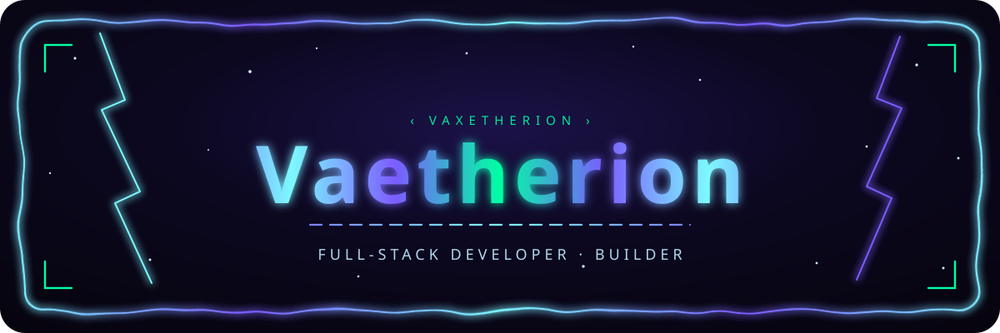

<!-- ═══════════════════════════════════════════════════════════════
  🐍 CHARACTER CALENDAR — Snake Animation + Divider
═══════════════════════════════════════════════════════════════ -->

  
   
  

<!-- ═══════════════════════════════════════════════════════════════
  🪪 IDENTITY — Portrait Aurora + Wordmark Terminal
═══════════════════════════════════════════════════════════════ -->

  
   
  

<!-- ═══════════════════════════════════════════════════════════════
  📋 ABOUT SECTION — Neon Theme
═══════════════════════════════════════════════════════════════ -->

  

<!-- ═══════════════════════════════════════════════════════════════
  🎯 FOCUS BANNER — Building in Public
═══════════════════════════════════════════════════════════════ -->

  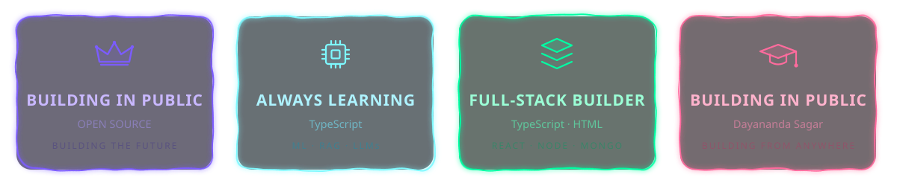

---

## 🛠️ Tech Stack

  

  

### 🔤 Technology Stack Logos

  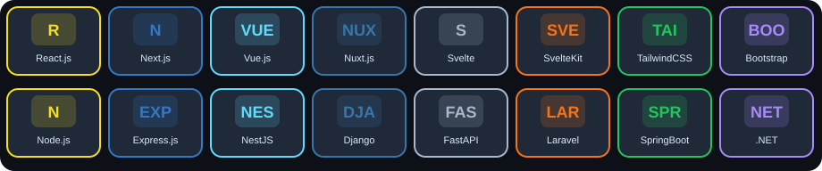

  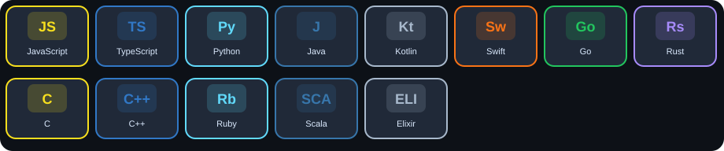

  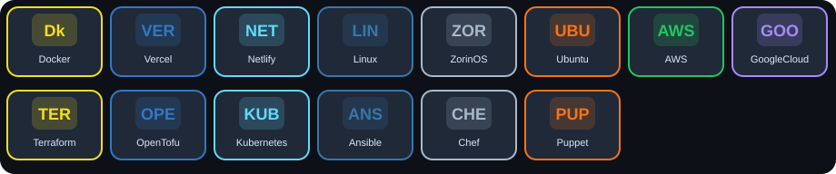

  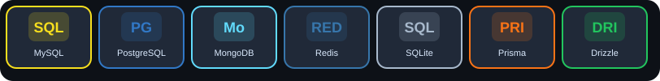

  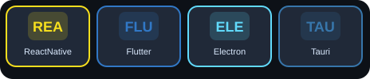

  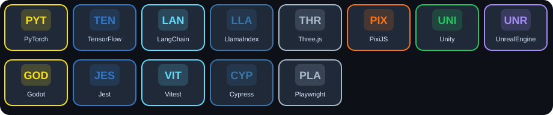

  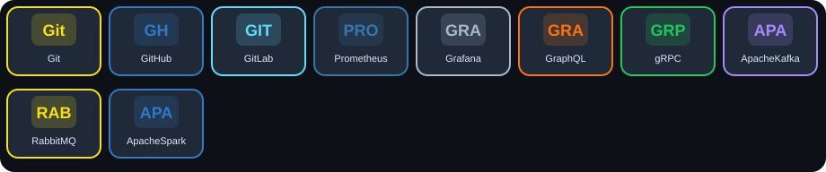

  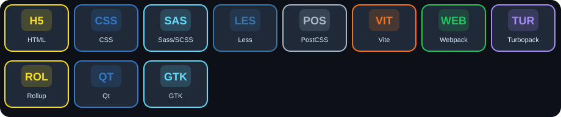

  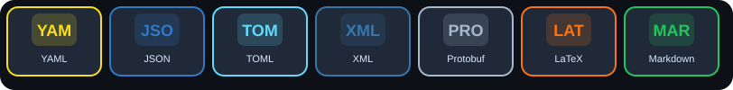

  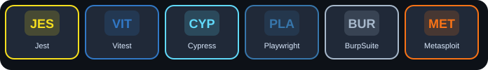

  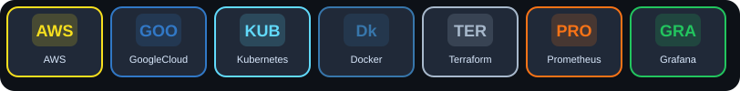

  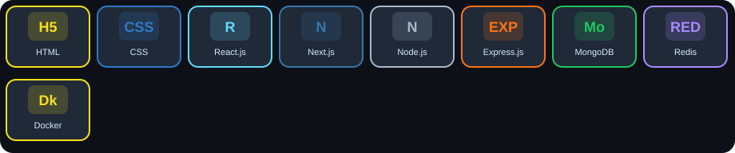

---

## 📊 Aktivitas & Statistik

  
   
  

### 🌡️ Heatmap Kontribusi

  
   
  
   
  
   
  

### 📈 Activity Graph

  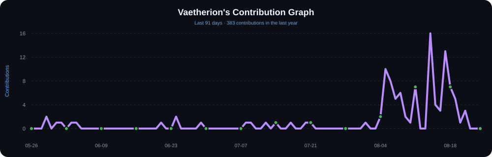

---

## 📂 Proyek & Mode Kompetitif

  
   
  

  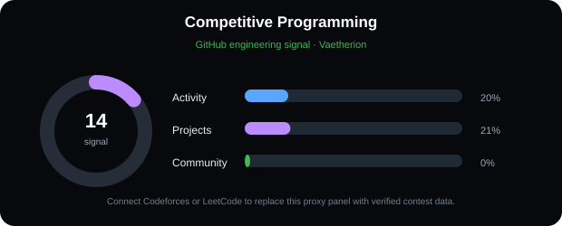

---

## 🌐 Social & Connect

  

---

## 👤 About — Terminal Mode

  

---

## 📸 Profil — Terminal Mode

  

---

## 🩺 Status & Otomasi

Profil ini dijaga otomatis oleh empat komponen yang saling melengkapi:

| Komponen | Jadwal | Tugas utama |
| :--- | :--- | :--- |
| **`refresh-assets.yml`** | Mingguan (Senin 03:00 UTC) + manual + saat `scripts/` berubah | Unduh & optimasi aset GitSkins, validasi E2E (API + fallback lokal), commit aset baru, buka/tutup issue otomatis, label `bug` + `automation`, assign, notifikasi, & peringatan durasi run > 10 menit |
| **`remind-issue.yml`** | Harian (06:00 UTC) | Pengingat otomatis bila issue *⚠️ Widget GitSkins gagal dimuat* terbuka > 3 hari |
| **`badges-check.yml`** | Mingguan (Rabu 05:00 UTC) + manual | Periksa badge workflow & badge pihak ketiga di README (`npm run badges:check`); buka/komentari issue otomatis *⚠️ Badge workflow di README bermasalah* bila ada yang rusak, tutup bila pulih, notifikasi Discord/Telegram |
| **`pr-validation.yml`** | Setiap pull request + push ke branch selain main | Lint actionlint + suite tes penuh (`npm test`) sebelum merge |
| **`notify`** (composite action) | Dipanggil keempat workflow di atas | Kirim notifikasi ke **Discord** dan/atau **Telegram** sesuai secret yang terisi |

> 🚨 Terjadi insiden? Ikuti panduan darurat langkah demi langkah di
> [docs/playbook-darurat.md](docs/playbook-darurat.md) — termasuk cara rollback
> ke fallback lokal (`npm run assets:swap`) dan pemulihan mode live.

---

## 📜 Changelog Otomasi

Evolusi otomasi profil dicatat di sini agar setiap perubahan bisa ditelusuri.

### v1.2.0 — 25 Agustus 2026

- **Perluasan aset GitSkins**: Menambah 24+ aset baru ke manifest — portrait aurora, about neon/terminal, social neon, heatmap neon/terminal, activity graph, character calendar (snake animation), dividers, focus banner, dan 12 varian technology-stack (frameworks, languages, databases, DevOps, AI/ML, mobile, testing, cloud, dll.).
- **Supply chain hardening**: `.npmrc` dengan `audit=true`, `audit-level=critical`, `package-lock=true`; `npm run audit` terintegrasi ke `npm test`.
- **Enhanced cleanup**: `npm run clean` sekarang juga menghapus `node_modules/`, lockfile lama, dan membersihkan cache NPM/Yarn/PNPM global.
- **Layout redesign**: README menggunakan tema cyberpunk hybrid (Neon + Aurora + Terminal) dengan semua aset GitSkins yang tersedia.

### v1.1.1 — 18 Agustus 2026

- **Perbaikan badge workflow**: URL badge di header README memakai nama repo
  yang benar (`vaxetherion/vaxetherions`, bukan `vaxetherion/vaxetherion`)
  sehingga kedua badge (Refresh & Remind) tidak lagi gagal dimuat (HTTP 404).
  Referensi nama repo di `docs/` dan `scripts/enable-branch-protection.sh`
  ikut disinkronkan; suite E2E kini memvalidasi badge workflow tetap dimuat
  (HTTP 200 + Content-Type gambar) agar kesalahan serupa terdeteksi lebih awal.
- **Validasi lintas repo** (`scripts/check-badges.js` / `npm run badges:check`):
  periksa badge workflow di README banyak repo sekaligus — nama repo di URL
  badge dicocokkan dengan nama aktual dari API GitHub, lalu badge dicek benar
  dimuat (termasuk badge pihak ketiga: shields.io, Codecov, badgen.net).
  Dijadwalkan mingguan oleh workflow `badges-check.yml` (Rabu 05:00 UTC) dengan
  laporan issue otomatis + notifikasi Discord/Telegram; dipakai juga sebagai
  acuan diagnosa di playbook darurat.

### v1.1.0 — 18 Agustus 2026

- **Pemicu issue lebih luas**: deteksi aset fallback lokal kosong/korup
  (`scripts/validate-assets.js`, step `validate_local_assets`) — issue kini
  terbuka bukan hanya saat API GitSkins gagal.
- **Siklus hidup issue otomatis penuh**: komentar diagnosa awal (step mana yang
  gagal), label `bug` + `automation`, assign ke pemilik repo, dan **auto-close**
  pada run berikutnya yang sukses.
- **Notifikasi eksternal**: composite action `.github/actions/notify` — Discord
  dan/atau Telegram (deteksi otomatis secret terisi) untuk momen: issue dibuat,
  run pulih, run > 10 menit, dan pengingat issue lama.
- **Pengingat harian** (`remind-issue.yml`): issue terbuka > 3 hari diingatkan
  otomatis tiap 3 hari hingga ditutup.
- **Validasi PR** (`pr-validation.yml`): lint actionlint + suite tes penuh
  sebelum merge.
- **Kualitas**: `npm test` kini mencakup validasi integritas aset lokal **dan
  lint actionlint** (`npm run lint`); unit test baru untuk `validate-assets.js`;
  badge status workflow; bagian Status & Otomasi; playbook darurat
  (`docs/playbook-darurat.md`); skrip branch protection
  (`scripts/enable-branch-protection.sh`).

### v1.0.0 — Baseline

- Workflow mingguan `refresh-assets.yml`: unduh & optimasi aset GitSkins,
  validasi E2E (API + fallback lokal), commit aset baru, dan pembukaan issue
  otomatis bila widget gagal dimuat.

---

## 🚀 Tentang Saya

> "Meskipun langkah awal terasa ambisius bagi seorang pemula, tekadku sudah bulat untuk menjadi Full-Stack Developer Profesional yang tangguh."

Halo! Saya **Aetherion** — seorang developer pemula yang sedang menapaki jalan panjang menuju **Full-Stack Developer Profesional**. Perjalanan kubangun di atas kejujuran, konsistensi, dan proyek nyata — bukan sekadar teori.

> "Jika informasi tidak pasti atau kamu tidak tahu, katakan 'Saya tidak tahu', jangan menebak."

| 👨‍💻 Identity | 🎯 Misi Utama | 💡 Filosofi Belajar |
| :--- | :--- | :--- |
| **Aetherion** (`vaxetherion`) | Menguasai arsitektur **Frontend, Backend, Database, hingga Security & DevOps** | Berani mencoba, pahami dasar, tingkatkan keahlian melalui proyek nyata secara konsisten |

---

## 📜 Link Penting

| Tautan | Keterangan |
| :--- | :--- |
| [Playbook Darurat](docs/playbook-darurat.md) | Panduan darurat saat widget GitSkins gagal dimuat |
| [Setup Repo](docs/setup-repo.md) | Langkah setup dari kloning hingga live di GitHub |
| [Security Audit](SECURITY.md) | Analisis celah keamanan & pertahanan supply chain |
| [Instagram](https://instagram.com/vaxetherion) | @vaxetherion |

---

## 🔮 Terus Bertumbuh

  

---

<!-- BEGIN:BADGES -->
  
  
  
  

  
  
<!-- END:BADGES -->
   
  Dibangun dengan tekad & kopi oleh <a href="https://github.com/vaxetherion" rel="noopener noreferrer">Aetherion</a> · Aset visual: <a href="https://www.gitskins.com" rel="noopener noreferrer">GitSkins</a> · <a href="docs/playbook-darurat.md" rel="noopener noreferrer">Playbook darurat</a> · <a href="docs/setup-repo.md" rel="noopener noreferrer">Setup repo</a>

